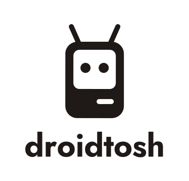
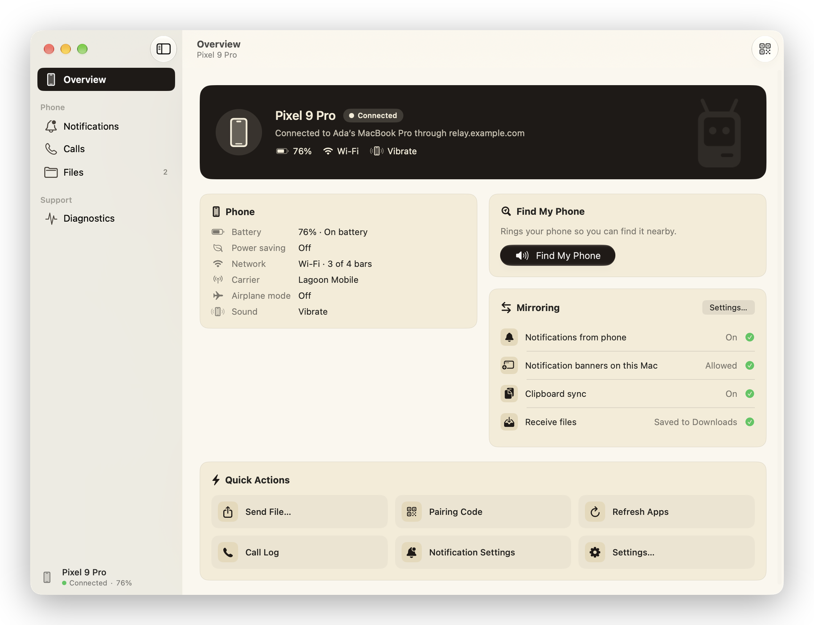
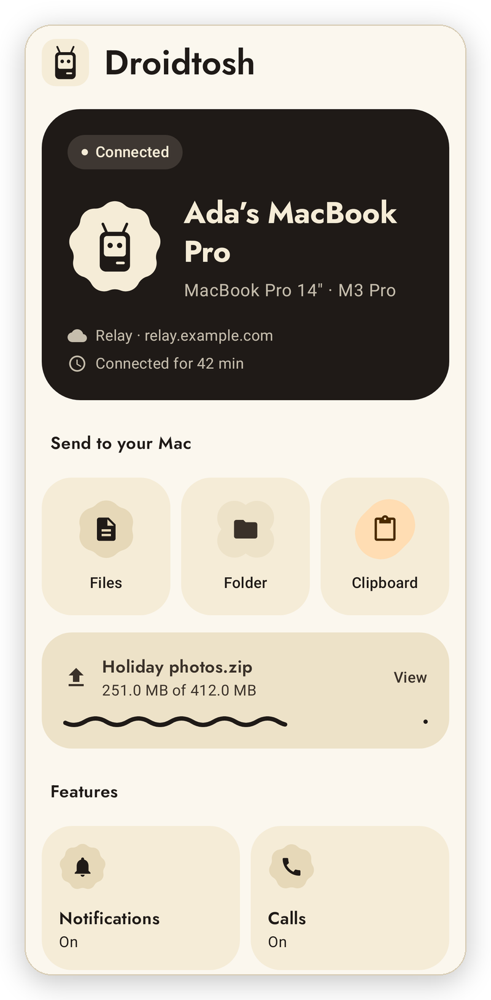
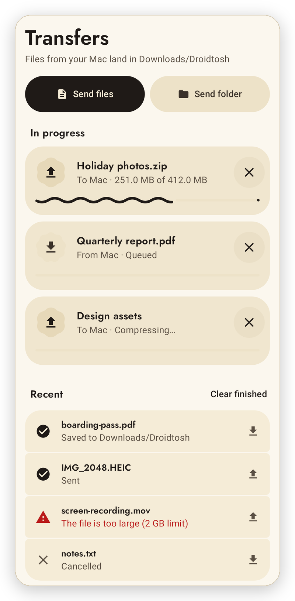
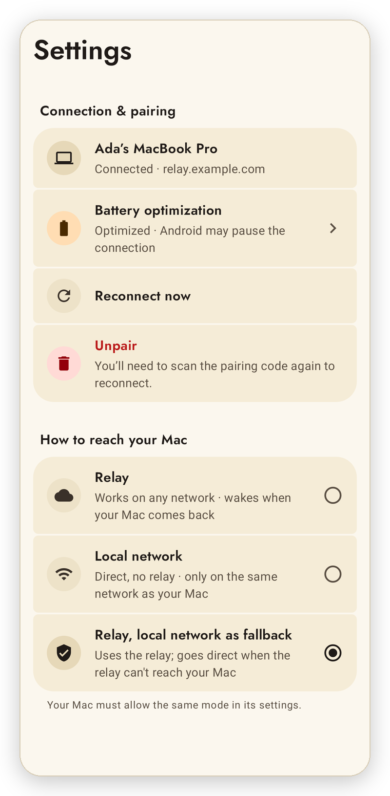
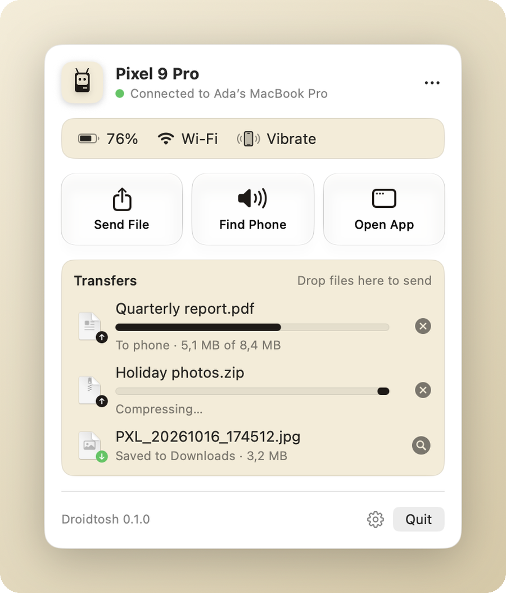
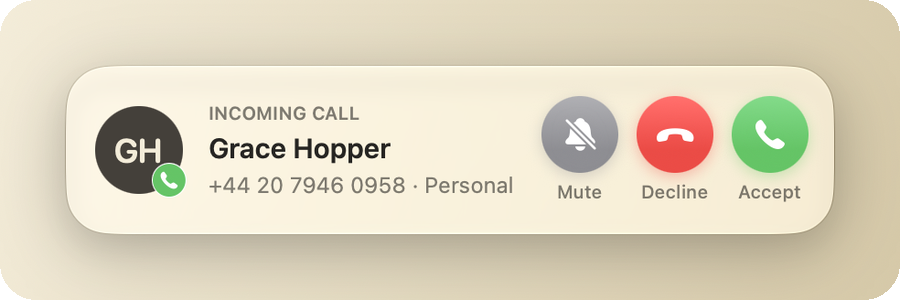

  <picture>
    <source media="(prefers-color-scheme: dark)" srcset=".github/brand/droidtosh-stacked-cream.svg">
    
  </picture>

<h3 align="center">Your Android phone, on your Mac.</h3>

  Notifications, calls, clipboard and files between an Android phone and a Mac, 
  over your local network or a relay you host yourself. End-to-end encrypted, no accounts.

  <a href="#install">Install</a> ·
  <a href="#features">Features</a> ·
  <a href="docs/PRIVACY.md">Privacy</a> ·
  <a href="relay/README.md">Self-host a relay</a> ·
  <a href="docs/TROUBLESHOOTING.md">Troubleshooting</a> ·
  <a href="CHANGELOG.md">Changelog</a> ·
  <a href="CONTRIBUTING.md">Contributing</a>

  
  
  
  
  

  <picture>
    <source media="(prefers-color-scheme: dark)" srcset=".github/screenshots/mac-overview-dark.png">
    
  </picture>

  <picture>
    <source media="(prefers-color-scheme: dark)" srcset=".github/screenshots/android-home-dark.png">
    
  </picture>
  <picture>
    <source media="(prefers-color-scheme: dark)" srcset=".github/screenshots/android-transfers-dark.png">
    
  </picture>
  <picture>
    <source media="(prefers-color-scheme: dark)" srcset=".github/screenshots/android-settings-dark.png">
    
  </picture>

  <picture>
    <source media="(prefers-color-scheme: dark)" srcset=".github/screenshots/mac-menu-bar-dark.png">
    
  </picture>
  <picture>
    <source media="(prefers-color-scheme: dark)" srcset=".github/screenshots/mac-call-dark.png">
    
  </picture>

## Features

- **Notifications.** Your phone's notifications as native macOS banners. Reply inline, use their actions, dismiss them on either side, and mute apps you don't want on the Mac.
- **Calls.** Answer, decline and mute incoming calls from the Mac, place calls (choosing the SIM on dual-SIM phones) and browse recent calls.
- **Clipboard.** Copy text or an image on one device, paste it on the other. Password-manager copies are never sent.
- **Files.** Send files and folders both ways, up to 2 GB, from the Mac's menu bar or any Android share sheet. Interrupted transfers resume.
- **Phone status.** Battery, network and sound mode in the menu bar, low-battery alerts, and **Find my phone** to ring it at full volume.
- **Updates.** Both apps update themselves from GitHub releases when you say so, with an opt-in beta channel.

## Install

1. Download the APK and the Mac app from [Releases](https://github.com/southstar21dev/Droidtosh/releases).
2. **Android:** open the APK and allow installing apps when asked. **Mac:** move Droidtosh to `/Applications`; the first time, right-click it and choose **Open**, since it isn't notarized by Apple.
3. On the Mac, open Droidtosh from the menu bar, choose how the phone connects (see below), and choose **Pair Your Phone**.
4. On the phone, open Droidtosh and scan the code.

Requires Android 13 or newer and macOS 15 or newer. Something not working? See [Troubleshooting](docs/TROUBLESHOOTING.md).

## How it connects

| Mode | How the phone reaches the Mac |
|---|---|
| **Local network** | Directly over the same Wi-Fi. Nothing to set up. |
| **Relay** | Through a small relay you run yourself, from any network. See [Self-host a relay](relay/README.md). |
| **Relay, local network as fallback** | Through the relay, or directly when the relay can't be reached. |

Either way, the phone and the Mac run their own encrypted session with a key exchanged when you pair, so a relay only ever forwards encrypted bytes. More in [Privacy](docs/PRIVACY.md) and the [protocol spec](protocol/PROTOCOL-v2.md).

## Contributing

Building from source, the repository layout and the test commands are in [CONTRIBUTING.md](CONTRIBUTING.md); releases are covered in [docs/RELEASING.md](docs/RELEASING.md). To report a security problem, see [SECURITY.md](SECURITY.md).

## License

Droidtosh is free software under the [GNU General Public License v3.0](LICENSE). The bundled Jost typeface is under the [SIL Open Font License 1.1](android/third_party/jost/OFL.txt).
